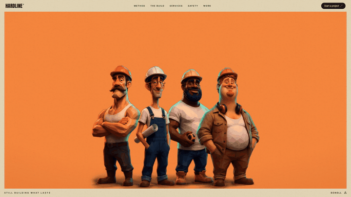
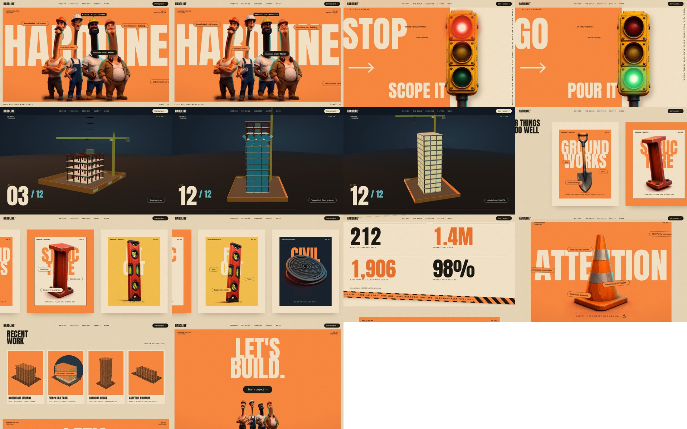

# HARDLINE Build Co.

A landing page concept for a construction company, built around four carved-wood caricature
workers with absurdly long necks.

**Live:** https://moh4696.github.io/hardline-construction/

> Design concept. HARDLINE is a fictional company: the projects, people and figures are placeholders.

## The idea

The brief was a construction landing page in a safety-orange poster style, with the crew in the hero
responding to the cursor. The crew got giraffe necks: on load the heads shoot up out of their
shoulders on springy necks, the giant HARDLINE sits across the necks, and from then on every neck bends
toward your cursor while the heads turn to look at it. Hover one of them and he stretches higher, his
callout inverts and his name tag shows. Scroll away and they crane after you.

## Sections

1. **Hero:** the long-neck crew (WebGL).
2. **Stop / Hold / Go:** a pinned split field; a worn roadworks traffic light changes lamps as you scroll.
3. **The Build:** a 12-storey tower assembles with scroll (three.js): footings, steel, crane-delivered
   beams, slabs, glass flipping in, then the lights come on floor by floor.
4. **Services:** a sideways poster series with a looping prop on each (shovel, I-beam, spirit level,
   manhole cover).
5. **Numbers:** odometer counters and hazard tape that speeds up with your scroll.
6. **Attention:** the safety poster; poke the cone.
7. **Recent work:** halftone cards that develop into colour under a lens that follows the cursor.
8. **Let's build:** hover the button and all four turn to look at it.

## How it works

- **The crew is one image, cut apart.** The four men were generated as a single image (Higgsfield) and
  keyed off a magenta backdrop. Each head and neck is cut into its own texture and erased from the body
  plate.
- **Necks are meshes.** Each head texture sits on a grid mesh. The rows between chin and neck base
  stretch to the new neck length (on a spring, so they pop) and lean along a curve toward the cursor; the
  rows above the chin turn on a shallow dome so the nose travels further than the ears, then roll with
  the neck (`js/crew.js`). It is a 2.5D warp of the one picture, not a new view.
- **Props are generated, then animated.** The traffic light, shovel, I-beam, spirit level, manhole cover
  and cone are Grok Imagine stills; the loops are MiniMax H3 clips whose first and last frames are the
  same still, so they loop seamlessly. Each clip is keyed to an H.264 file with colour on top and the
  matte below, recombined in a shader so it works in Safari too (`js/props.js`).
- **One renderer, many canvases.** Small scenes (posters, cone, project renders) share one offscreen
  WebGL renderer that copies each view into its own 2D canvas (`js/kit.js`).
- **Stack:** plain HTML/CSS/JS, three.js r169, GSAP 3.13 + ScrollTrigger, Lenis. No build step.

Run it locally with any static server, for example `python3 -m http.server` in this folder.

`PROMPT.md` describes how the project was made and gives a prompt that recreates it;
`prompts/asset-prompts.md` lists every image and video prompt.

## Credits

Built with Claude Code (Claude Opus 5.5). Characters and props made with Higgsfield. Style references:
Fady Shohdy's faceted 3D portraits (characters) and Philybric's concept posters (layout, type, colour).
Anton and Inter Tight via Google Fonts.
